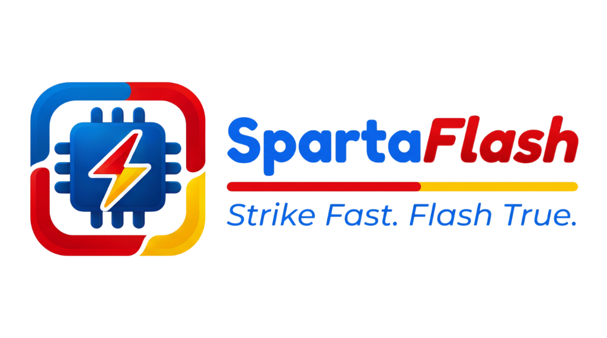

<p align="center">
  
</p>

<p align="center">
  <strong>Industrial IoT Firmware Provisioning & Live Diagnostics Workstation</strong><br>
  <em>STRIKE FAST. FLASH TRUE.</em>
</p>

<p align="center">
  <a href="https://github.com/rohidfkra777/SpartaFlash/releases/tag/v1.3.0"></a>
  <a href="https://github.com/rohidfkra777/SpartaFlash"></a>
  <a href="LICENSE"></a>
</p>

---

## 📌 Overview

**SpartaFlash** is an enterprise workstation designed for high-throughput firmware provisioning, hardware quality control, and real-time telemetry diagnostics of Smart IoT devices (Smart Plug and CT Current Transformer energy monitors).

Engineered for factory production lines and maintenance workshops, SpartaFlash streamlines flashing workflows with deterministic hardware safety checks, acoustic audio feedback, and dynamic store-code topology grouping.

---

## ⚡ Key Capabilities

* **⚡ High-Speed Flash Station**: Single-click firmware flashing with automated post-write integrity verification and silicon MAC address binding.
* **🔊 Acoustic Pass/Fail Feedback**: Non-blocking audio beeps (cheerful chime for PASS, descending buzz for FAIL) for eyes-free operator workflow.
* **📡 Real-Time MQTT Diagnostics**: Live telemetry feed tracking Voltage, Current, Active Power (Watt), Power Factor, and Frequency.
* **🏪 Dynamic Store Code Grouping**: Automatic roster categorization by store code hierarchy (`kodetoko/namapanel/fasa`) with self-cleaning lifecycle.
* **🔒 Role-Based Access Control**: Dual-tier security (Admin & Operator) preventing accidental parameter tampering.
* **📊 Compliance Audit Trail**: Automated transaction logging with one-click manufacturing CSV export.

---

## 📦 Distribution & Packaging

For production workstations, standalone Windows packages are structured as follows:

```text
SpartaFlash/
├── SpartaFlash.exe          # Official Workstation Executable
├── assets/                  # Brand icons and factory firmware profiles
├── drivers/                 # Certified USB UART Drivers (CH340 & CP210x)
└── README.md                # Operator documentation
```

### Official Windows Installer (.exe):
Download the latest verified setup installer from [**GitHub Releases**](https://github.com/rohidfkra777/SpartaFlash/releases/tag/v1.3.0):
* **Package**: `SpartaFlash_Setup_v1.3.0_Windows_x64.exe`
* **Target System**: Windows 10 / 11 (64-bit)
* **Installation**: Per-user setup (installs to `%LOCALAPPDATA%\Programs\SpartaFlash` without requiring Administrator privileges).

---

## 🔌 Hardware Safety & Pre-Flashing Instructions

> [!CAUTION]
> **HIGH VOLTAGE SAFETY NOTICE - DISCONNECT AC MAINS!**
> Never connect programming cables while the device is plugged into AC mains electricity (110V/220V). Always ensure complete electrical isolation prior to connecting USB-UART interfaces.

1. **Isolation**: Verify the target device is completely isolated from high-voltage lines.
2. **Logic Voltage**: Ensure the USB-UART adapter logic level is set to **3.3V** (ESP GPIO pins are not 5V-tolerant).
3. **Driver Setup**: Install CH340 or CP210x drivers (included in the installation wizard) if the COM port is not detected.

---

## 🚀 Quick Operation Workflow

1. **Launch**: Open **SpartaFlash** from Desktop or Start Menu.
2. **Select Device**: Choose target hardware profile (**Smart Plug** or **Smart CT**).
3. **Connect**: Plug the USB-to-UART cable and select the active **COM Port**.
4. **Flash**: Click **START FLASHING** and confirm the safety checklist.
5. **Verify**: The workstation completes write verification and emits an acoustic signal:
   - 🟢 **PASS**: Green badge + Success Chime.
   - 🔴 **FAIL**: Red badge + Error Alert.
6. **Live Monitor**: Switch to **Device Monitor** to view real-time MQTT telemetry and store grouping.

---

## 👨‍💻 Developer & Attribution

- **Application**: SpartaFlash
- **Version**: `1.2.3`
- **Lead Developer**: **Rohidfkra777** ([GitHub Profile](https://github.com/rohidfkra777) | [Email](mailto:rohidfkra.unp@gmail.com))
- **Repository**: [https://github.com/rohidfkra777/SpartaFlash](https://github.com/rohidfkra777/SpartaFlash)
- **Copyright**: © 2026 Rohidfkra777. All rights reserved.
